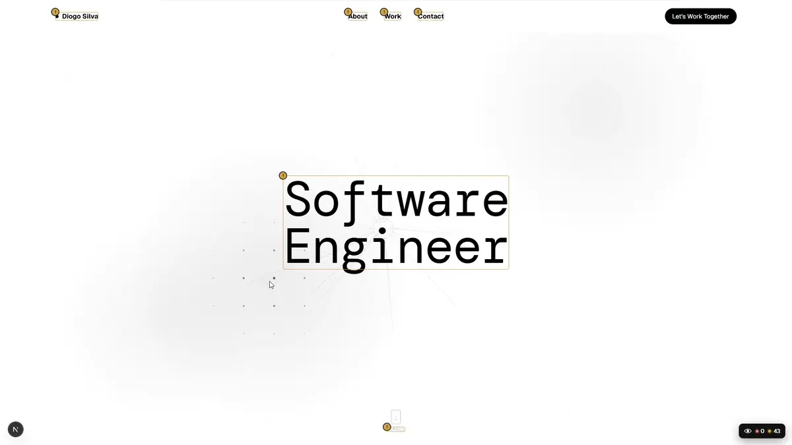

<div align="center">

<picture>
  <source media="(prefers-color-scheme: dark)" srcset=".github/assets/logo-dark.svg">
  
</picture>

# OdinEye

**See accessibility, SEO and layout problems on your page while you build it.**

[](https://www.npmjs.com/package/odin-eye)
[](https://www.npmjs.com/package/odin-eye)
[](https://bundlephobia.com/package/odin-eye)
[](LICENSE)

[Website](https://odin-eye.vercel.app) · [Playground](https://odin-eye.vercel.app/playground) · [npm](https://www.npmjs.com/package/odin-eye) · [Report an issue](https://github.com/SRamoras/odin-eye/issues/new/choose)

<br>

<a href="https://odin-eye.vercel.app"></a>

</div>

---

Most audit tools give you a report after the fact: a score, a list of selectors, a tab you have to switch to. OdinEye puts the problem **on the element itself**, in your running app, while you are still writing the code.

Add one component. Every image without alt text, every button without a name, every element that makes the page scroll sideways gets outlined, and hovering it tells you what is wrong and how to fix it.

## Features

- 🎯 **On the page, not in a report.** Problems are outlined where they are, with a badge on each one.
- 💬 **Explains the fix.** Hover a marked element to read what is wrong and what to change.
- 📋 **One panel for everything.** All issues in one list, filtered by category. Click one to scroll to it.
- 🔄 **Keeps up with your app.** Checks run again on route changes, new content and late-loading images.
- 🪶 **Zero config.** No options, no setup files, no browser extension.
- 🧱 **Stays out of the way.** The page stays clickable and the overlay's styles are scoped, so they never touch yours.
- ⚡ **SSR safe.** Renders nothing on the server and starts in the browser.

## Quick start

```bash
npm install -D odin-eye
```

Then render it once, behind a development check:

```tsx
import { OdinEye } from "odin-eye";

export default function App() {
  return (
    <>
      {/* your app */}
      {process.env.NODE_ENV === "development" && <OdinEye />}
    </>
  );
}
```

That's it. Open your app and look at the bottom right corner.

Setup for Next.js (App and Pages Router), Vite, Remix / React Router and Gatsby is in the [package README](packages/odin-eye/README.md#usage).

## Works with

|   React   |       Next.js        |      Vite       | Remix / React Router | Gatsby |   TypeScript   |
| :-------: | :------------------: | :-------------: | :------------------: | :----: | :------------: |
| 18 and up | App and Pages Router | React templates |          ✓           |   ✓    | Types included |

## What it checks

25 checks across three categories. 🔴 error · 🟡 warning

<details>
<summary><b>Accessibility</b> (9)</summary>

| Check                          |     |
| ------------------------------ | :-: |
| Button without accessible name | 🔴  |
| Link without accessible name   | 🔴  |
| Image without alt text         | 🔴  |
| Form field without label       | 🔴  |
| Duplicate id                   | 🔴  |
| Page without language          | 🔴  |
| Page without title             | 🔴  |
| Skipped heading level          | 🟡  |
| Multiple `<h1>` headings       | 🟡  |

</details>

<details>
<summary><b>SEO</b> (10)</summary>

| Check                     |     |
| ------------------------- | :-: |
| Missing meta description  | 🔴  |
| Missing viewport meta tag | 🔴  |
| Page without `<h1>`       | 🔴  |
| Meta description length   | 🟡  |
| Page title length         | 🟡  |
| Missing canonical link    | 🟡  |
| Missing Open Graph tags   | 🟡  |
| Link without destination  | 🟡  |
| Generic link text         | 🟡  |
| Page is set to noindex    | 🟡  |

</details>

<details>
<summary><b>UI and layout</b> (6)</summary>

| Check                       |     |
| --------------------------- | :-: |
| Element wider than the page | 🔴  |
| Broken image                | 🔴  |
| Distorted image             | 🟡  |
| Image larger than needed    | 🟡  |
| Touch target too small      | 🟡  |
| Text too small              | 🟡  |

</details>

Want to see them fire? The [playground](https://odin-eye.vercel.app/playground) has a wrong and a right example of every check.

## Repository

This is an npm workspaces monorepo.

```
odin-eye/
├── packages/
│   └── odin-eye/     the library published to npm
└── apps/
    └── web/          the website and playground (Next.js)
```

### Development

```bash
git clone https://github.com/SRamoras/odin-eye.git
cd odin-eye
npm install

# rebuild the library on every change
cd packages/odin-eye && npm run dev

# in another terminal, run the website on localhost:3000
cd apps/web && npm run dev
```

## Contributing

Found a false positive, a problem OdinEye missed, or have an idea for a new check? [Open an issue](https://github.com/SRamoras/odin-eye/issues/new/choose); there is a template for each case.

Pull requests are welcome. Read the [contributing guide](CONTRIBUTING.md) first: it covers running the project, testing in your own app and adding a check.

## License

[MIT](LICENSE) © SRamoras
